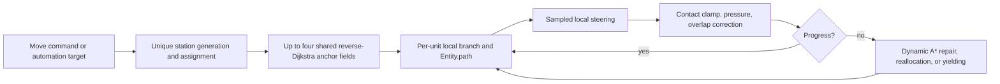

# Formation Control and Pathfinding Algorithm Report for AIRTS

**Status:** Historical, unaccepted design proposal; not the current implementation contract

This report describes its recorded July baseline and proposed alternatives. Its measurements were
not rerun in the September audit. Several implementation claims are stale: the current runtime has
a separate large-force lattice controller and more performance workloads. References to an
unavailable movement document and ADR 0008 have been corrected below. Use the
[design index](../design.md), [performance milestones](../milestones/performance.md), and
[ADR 0006](../decisions/0006-stable-incremental-crowd-state.md) for current behavior.
**Audience:** AIRTS maintainers implementing a future movement revision
**Repository baseline reviewed:** working tree as inspected on 2026-07-28
**Scope:** formation planning, group routing, local avoidance, congestion recovery, migration,
and validation for the current 64 × 64 weighted-grid simulation

## Technical summary

AIRTS does not currently use one named formation/pathfinding algorithm. It uses a deterministic
hybrid:

- **Global static routing:** cached, weighted, four-neighbor **reverse Dijkstra navigation
  fields** (`Pathfinder._build_field`). A field may have one or several goal cells and stores one
  deterministic next cell for every reachable cell.
- **Dynamic/local repair:** ordinary four-neighbor **A\*** with a Manhattan heuristic scaled by the
  minimum terrain cost (`find_path`), plus a cheap horizontal-first/vertical-first **L-corridor**
  test before A* for short branches (`find_local_path`).
- **Direct group destinations:** breadth-first expansion from the clicked target to obtain unique
  passable cells, followed by approach-axis sorting that pairs front units with front slots.
- **Group route sharing:** at most four destination-derived anchor lanes; each unit follows the
  cached field toward its nearest anchor and branches within eight Manhattan cells of its own
  station.
- **Defend formations:** equal-distance samples along polylines or sampled area/perimeter points
  when those have enough clearance; otherwise cached hexagonal packing around the target.
- **Defend slot assignment:** coordinate sorting for at most 128 units, cubic Hungarian
  minimum-cost assignment for 129–512 units, and approach-axis sorting above 512. Existing valid
  stations are retained when membership changes.
- **Patrol formations:** up to five columns with trailing rows along a polyline; area patrols use
  packed gathering slots indexed by stable entity order.
- **Local movement:** deterministic sampled steering. It scores the desired direction, one
  separation blend, and fixed turns at ±22.5°, ±45°, ±67.5°, and ±90°. A uniform-grid
  `SpatialIndex` supplies neighbors. Motion is clamped to collider contact, followed by mass-aware
  pressure propagation and bounded overlap correction.
- **Recovery:** progress timeouts, staggered retry phases, dynamic A* with mobile-unit penalties,
  crowded-destination reassignment, and an eight-neighbor sidestep followed by replanning.

That answer is supported directly by
[`pathfinding.py`](../../src/airts/navigation/pathfinding.py),
[`collision.py`](../../src/airts/navigation/collision.py),
[`command_handlers.py`](../../src/airts/systems/command_handlers.py),
[`movement.py`](../../src/airts/systems/movement.py),
[`automations.py`](../../src/airts/automations.py), and
[`automation_runtime.py`](../../src/airts/systems/automation_runtime.py).

The recommended target is an incremental hybrid, not a clean-sheet rewrite:

1. **Keep the cached reverse-Dijkstra fields and the `RoutingService` boundary.** They fit a
   4,096-cell weighted map and many units sharing goals better than per-unit A*, HPA*, D* Lite, or
   MAPF.
2. **Remove the size-dependent Hungarian assignment.** Use the existing stable retention plus one
   deterministic approach-axis/order-preserving assignment for all remaining units. This changes
   worst-case assignment from \(O(n^3)\) time and \(O(n^2)\) memory to \(O(n \log n)\).
3. **Make dynamic repair cheaper without changing path meaning.** Reuse precomputed neighbor/cost
   arrays, a touched-node A* workspace, and one per-tick obstacle/penalty snapshot. Do not build the
   same mobile-obstacle maps separately for every stalled unit.
4. **Add a grid-specific clearance corridor over the existing route fields.** Convert a group
   backbone into deterministic formation checkpoints: broad ranks on open terrain, fewer columns
   before a choke, single file where required, and expansion after exit. Compile those checkpoints
   into the existing per-entity `PathResult`; do not add a parallel movement controller.
5. **Prototype deterministic ORCA-style reciprocal velocity constraints as a replacement for the
   sampled candidate stage only.** Reuse `SpatialIndex`, route waypoints, collision radii, occupancy,
   speed limits, physical overlap correction, progress evidence, and recovery. Do not enable it by
   default until it beats the current controller on deterministic choke, crossing, persistence, and
   p95 tick benchmarks.
6. **Do not adopt WHCA*, CBS, Continuum Crowds, pure boids/leader-following, HPA*, or D* Lite in the
   current milestone.** They either introduce space-time reservation state, scale poorly with
   hundreds of agents, weaken individual authority, or solve map sizes/change rates AIRTS does not
   currently have.

The strongest measured inefficiency is formation assignment, not the shared global routing core.
On the inspected AMD Ryzen 9 9900X3D / Python 3.13.14 environment, a single synthetic invocation of
the current Hungarian function took 0.078 s at 129 units, 0.616 s at 256, and 5.474 s at 512. These
are one-shot local measurements, not portable performance promises. The repository's two existing
performance tests passed in 1.47 s total without profiling (0.59 s for 1,000 opposing scouts over
10 ticks; 0.84 s for 96 defenders over 300 ticks). Under `cProfile`, movement consumed 3.068 s of
4.341 s; 183 dynamic A* calls consumed 0.907 s, steering candidate generation 0.454 s, crowded
waypoint skipping 0.396 s, shared-path work 0.303 s, and collision resolution 0.220 s. Profiling
overhead makes those elapsed values unsuitable as release targets, but their relative shares justify
optimizing repair reuse before replacing shared fields.

## Scope, evidence, and confidence

### Authoritative project constraints

The following constraints were assumptions of this proposal. Current authoritative constraints
live in [`AGENTS.md`](../../AGENTS.md), the [design index](../design.md), and
[ADR 0006](../decisions/0006-stable-incremental-crowd-state.md); the single-pipeline assumption
below does not describe the current large-force controller:

- `Simulation` remains authoritative and the stable public facade.
- The simulation stays headless, fixed at 10 Hz, and independent of Pygame or model providers.
- Commands remain the only control boundary.
- Same initial state, seed, command sequence, and movement-algorithm version must reproduce state
  and events.
- Four-direction weighted terrain and hard building topology remain authoritative.
- Every unit remains simulated; no large-force shortcut may remove collision or change command
  meaning.
- Derived navigation fields, clearance maps, spatial indexes, and ORCA constraints must be
  rebuildable.
- Failures stay explicit.

There is no accepted ADR 0008 in this repository. Any future checkpoint or ORCA proposal must be
evaluated against ADR 0006 and the current crowd contracts, and record a superseding decision if it
changes those contracts.

### Evidence reviewed

The source review covered all modules that own or invoke routing, stations, movement, occupancy, and
automation behavior, plus the movement, unit, integration, architecture, and performance tests.
Important executable contracts include:

- deterministic routes through gaps and across bridges;
- weighted terrain selection and explicit no-path failures;
- shared navigation-field reuse and route budgets;
- head-on and perpendicular passing without overlap;
- stable arrival without shaking;
- unique reserved destinations;
- front-to-back convoy assignment;
- four-way choke completion;
- pushing/yielding with unit mass;
- same-seed snapshot and event equality;
- bridge crossing and shared defend-station convergence;
- opposing 500-unit group progress; and
- 96-unit defense convergence.

No production trace, user-provided profiler output, p50/p95 tick distribution, memory profile, or
large-map workload was available. Therefore this report can identify complexity and measured local
hotspots, but it cannot claim that ORCA or clearance corridors will improve production performance
until the proposed benchmark gates pass.

### External research basis

Primary or publisher-hosted sources used for the comparison are listed in
[Research references](#research-references). Algorithm results from those papers are not treated as
AIRTS results. Suitability statements below are engineering inferences from the papers plus the
current code and constraints.

## Existing movement architecture and observed problems



### Ownership and data flow

| Current component | Actual responsibility | State classification |
| --- | --- | --- |
| `Simulation` | Tick order, facade wrappers, route/cache ownership, direct destinations, packed gathering slots | Authoritative plus derived caches |
| `RoutingService` / `Pathfinder` | Static reverse fields, dynamic A*, local L-path, per-tick route budgets | Derived |
| `PathResult` | Cells, continuous waypoints, weighted cost | Derived at planning; copied into entity state |
| `Entity` | Position, final target, remaining waypoints, cost, progress/yield evidence | Authoritative and serialized |
| `DefendParameters` | Target, entity-to-station map, packed slots, assembly radius | Authoritative and serialized |
| `automations.py` helpers | Patrol/defend samples, Hungarian and sorted matching, station retention | Pure planning |
| `command_handlers.py` | Command validation, direct group station allocation, shared-lane path compilation | Command system |
| `automation_runtime.py` | Route scheduling, station recovery/retention, shared-defense coordination | Tick system |
| `movement.py` | Local movement, collision, progress, replan, blocked recovery | Tick system |
| `SpatialIndex` | Uniform-grid broadphase with sorted query results | Derived per tick |
| `OccupancyGrid` | Authoritative hard footprint placement and cell occupants | Authoritative |

The architecture already has the right main seams: `RoutingService`, `PathResult`, `SpatialIndex`,
`Entity.path`, and authoritative station maps. A future implementation should extend those seams
instead of adding a second navigator, a formation manager, or a separate crowd-world model.

### What is working well

1. **Shared reverse fields match group routing.** For one goal-set and blocked-cell set, one weighted
   search serves every start. Field construction is \(O((V+E)\log V)\) with the current heap;
   route extraction is \(O(L)\) per unit. On a 64 × 64 four-neighbor grid, \(V=4,096\) and
   \(E < 4V\).
2. **Static and dynamic data are separated.** Unit-dependent penalties do not pollute the 32-entry
   static field cache.
3. **Tie-breaking is explicit.** Goal, neighbor, entity, coordinate, and steering order make replay
   behavior inspectable.
4. **Formation destinations are unique and physically spaced.** Packed defend slots use collision
   radius and hexagonal spacing; station retention avoids unnecessary turns when membership changes.
5. **The pipeline is universal.** Large groups do not disappear into a different controller.
6. **Failure and liveness state are visible.** Blocked/yielded/path events and persisted progress
   state support diagnosis and replay.

### Observed architectural and algorithmic problems

#### 1. Cubic formation assignment has a severe threshold cliff

`_allocate_defend_stations` uses three different assignments:

- `n <= 128`: sort by `(y, x, id)` and zip;
- `129 <= n <= 512`: full Hungarian minimum squared-distance matching;
- `n > 512`: approach-axis sort and zip.

The Hungarian implementation materializes an \(n \times n\) cost matrix and runs \(O(n^3)\) work.
The measured 512-unit call took 5.474 s, while 256 took 0.616 s. The performance suite uses 96
defenders, so it never exercises this branch. The size threshold creates a non-monotonic quality and
latency discontinuity: 512 can be much slower than 513. This is not a second movement controller,
but it is exactly the kind of hidden scale-dependent policy that makes behavior difficult to reason
about.

#### 2. Dynamic repair repeats world scans and fresh A*

Each stalled replan:

- scans entities to build fixed obstacles;
- scans entities again to build cell penalties;
- allocates new A* dictionaries and heap entries;
- repeatedly calls `GameMap` accessors for a grid whose neighbors and terrain costs are already
  precomputed inside the static `Pathfinder`.

The profiler observed 183 dynamic paths in the two smoke workloads. A four-per-tick budget bounds
spikes but does not remove duplicated input construction or search allocation.

#### 3. Local steering is reactive and candidate-limited

The solver tests at most ten directions and evaluates each against all nearby positions. It does not
use neighbor velocity or a prediction horizon. It therefore responds after a body obstructs the next
step, not before two trajectories become unsafe. The fixed left-pass preference helps two-agent
symmetry but is not a proof of progress for dense bidirectional traffic. The later pressure and
repair stages carry much of the burden.

#### 4. Formation planning is split across four owners

Station sampling and matching live in `automations.py`; direct destination BFS and hex packing live
on `Simulation`; lane compilation lives in `command_handlers.py`; retention and recovery live in
`automation_runtime.py`. These are not duplicate runtime controllers, but the split makes it hard to
state one invariant for slot generation, clearance, assignment, deformation, and recovery.

#### 5. Formation is primarily a destination property

Direct groups get shared anchors, but there is no explicit clearance model along the route. A broad
formation discovers a choke through local contacts and deforms reactively. Patrol line offsets only
test whether a candidate point is passable, not whether the segment and unit radius fit. The current
design therefore cannot deliberately become single file before a bridge and expand after it.

#### 6. Sequential movement introduces avoidable order effects

Units are processed in canonical entity order, and the spatial index is updated after each move.
This is deterministic, but later units observe already-moved positions while earlier units observed
the start-of-tick snapshot. Determinism is preserved; reciprocity and visual fairness are weaker.

#### 7. Some caches are rebuilt too often or too broadly

`SpatialIndex` is rebuilt for every movement tick, and each nearby query sorts its result.
Construction/removal correctly invalidates all navigation and gathering caches, but the current
cache has no topology revision or affected-field repair. These are secondary costs at current map
size; they should be optimized only after measurement.

## Candidate algorithms

### 1. Cached weighted reverse Dijkstra fields — retain directly

#### Overview

Reverse Dijkstra starts from one or more goals and propagates minimum weighted cost outward. Each
cell stores its best successor toward a goal. AIRTS already implements this as `_NavigationField`.
It solves the exact current problem: many starts, few shared destinations, non-negative weighted
terrain, four-neighbor topology, and deterministic static obstacles.

With a binary heap, construction is \(O((V+E)\log V)\), storage is \(O(V)\), and extracting a route
is \(O(L)\). Multiple goal cells are handled by seeding all goals at cost zero. The cache key
contains the available goal set and blocked cells.

Advantages are exact weighted paths, excellent reuse across a group, simple tie-breaking, and no
per-agent solver state. Limitations are full reachable-grid work for every new goal/blocked key,
\(O(V)\) memory per cached field, and full invalidation after topology changes.

#### Mechanics in AIRTS terms

1. Validate start and all goals through `GameMap`.
2. Convert goals and blocked cells to integer indices.
3. Push every goal into a min-heap with cost zero.
4. Pop the lowest `(cost, goal_index, cell_index)`.
5. Relax cardinal predecessors using the cost of entering the current cell.
6. Resolve equal costs by smaller goal index and then smaller next-cell index.
7. Store `costs[cell]`, `next_indices[cell]`, and the selected goal.
8. From each entity start, follow `next_indices` until a goal; convert cells to center waypoints and
   preserve the exact continuous goal at the end.

Formation movement remains external: one field can guide many units toward an anchor, and each unit
branches to its station. Static obstacles and narrow passages are respected by topology, but the
field does not model passage capacity. Dynamic units are intentionally absent from the cache.

#### Recommendation

Use it directly and preserve `RoutingService.shared_path`, `PathResult`, the 32-field bounded cache,
and deterministic tie-breaking. Add metrics for hits, misses, build expansions, and extraction
length. Only replace the heap with a bucket/radix queue after a benchmark: AIRTS terrain costs can
be scaled to small integers, but Python bucket overhead may erase the theoretical benefit.

### 2. Array-backed A* for dynamic repair — use directly, but improve the implementation

#### Overview

A* is Dijkstra ordered by \(f(n)=g(n)+h(n)\). AIRTS uses
\(h=0.75(|dx|+|dy|)\), which is admissible because road cost 0.75 is the minimum cell cost.
It is complete and optimal for the current non-negative weighted four-neighbor graph. Worst-case
time is \(O((V+E)\log V)\) with a heap and memory is \(O(V)\), although a useful heuristic normally
expands less than Dijkstra.

It is suitable for the relatively small number of unit-dependent repairs because each repair can
have different mobile-unit penalties and fixed bodies. It is unsuitable as the main group
algorithm because repeated starts to shared goals discard the reverse-field reuse.

#### Mechanics and relevant cases

1. Take the entity's current cell, final `move_target`, fixed building/held cells, and non-negative
   mobile-cell penalties.
2. Initialize `g(start)=0`; push start with `g+h`.
3. Pop the stable minimum `(f, g, y, x)`.
4. For each cardinal neighbor, reject impassable/fixed cells.
5. Relax with terrain movement cost plus mobile congestion penalty.
6. Stop when the target is popped and reconstruct parents.
7. If no path exists, preserve the previous route and expose the failed recovery; do not teleport or
   silently clear the order.

Local repair handles a new settled unit or a crowded final approach. It does not coordinate several
units jointly, so ORCA/formation checkpoints and existing yielding remain necessary.

#### Recommendation

Retain the semantics, but route `RoutingService.dynamic_path` through an internal reusable workspace
that uses the same precomputed neighbor and terrain arrays as `Pathfinder`. Use generation counters
or a touched-index list so one search resets only visited cells. Build one sorted
`RecoveryObstacleSnapshot` per tick and remove the searching entity's own cells at query time.

### 3. Weighted Jump Point Search (JPSW) — benchmark later; do not adopt now

#### Overview

JPSW prunes symmetric path permutations on weighted grids while preserving at least one optimal path
to every cell. Its published evaluation reports large speedups over online A* on weighted game maps.
Its worst-case search class remains comparable to A*, but fewer expanded nodes can make individual
queries much faster.

#### Mechanics

JPSW uses a weight-aware tie-breaking policy and pruning rules to skip ordinary grid successors and
jump to forced or otherwise significant points. A* then searches this reduced successor set.
Weighted costs complicate the pruning compared with classic uniform-cost JPS.

For AIRTS, it could replace only the unit-dependent `dynamic_path` search. Formation, local
avoidance, congestion, and group coordination would remain unchanged. Dynamic penalties alter
weights per tick and per excluded entity, reducing repeated symmetry and making correctness more
difficult to validate. Four-direction support, exact tie-breaking, hard building cells, and the
continuous final waypoint would need an AIRTS-specific proof and regression suite.

#### Recommendation

Do not implement JPSW in the first migration. First remove repeated world scans and dictionary
allocation from A*. If node expansion count remains the measured bottleneck, implement JPSW behind
the same `RoutingService.dynamic_path` contract and compare exact path cost and deterministic
results against A* on every map fixture.

### 4. HPA* — reject for the current map; reserve for larger-map research

#### Overview

Hierarchical Path-Finding A* partitions a large grid into clusters, precomputes entrances and
intra-cluster routes, searches the abstract graph, and refines the result. The original evaluation
reported paths within roughly 1% of optimal and up to 10× faster than optimized A* on its tested
large maps.

#### Mechanics

1. Partition the grid into fixed clusters.
2. Detect passable entrances across cluster borders.
3. Precompute shortest connections among entrances inside each cluster.
4. Insert start and goal into their clusters.
5. Run A* on the abstract entrance graph.
6. Refine abstract edges into grid paths.
7. Repair affected clusters when topology changes.

Clearance annotations can indicate whether a passage fits a formation width, but HPA* itself does
not manage stations, moving obstacles, congestion, or local collision.

#### Recommendation

Reject it for the current 64 × 64 map. Four reverse fields over 4,096 cells are simpler and exact.
HPA* adds cluster sizing, entrance invalidation, refinement, and near-optimality trade-offs without
evidence that global field construction is the bottleneck. Reconsider only after a roadmap milestone
introduces materially larger maps and field construction exceeds an agreed profile threshold.

### 5. D* Lite / Lifelong Planning A* — reject now; reconsider for frequent topology edits

#### Overview

D* Lite reuses prior search information when edge costs change, combining incremental repair with
heuristic focus. Its benefit appears when a sequence of searches shares a goal and most of the graph
while a small set of edge costs changes.

#### Mechanics

D* Lite keeps `g` and one-step-lookahead `rhs` values, a priority queue keyed by their inconsistency
and a heuristic term, and updates only vertices affected by changed edges. Repeated
`compute_shortest_path` calls restore consistency from the current start toward the goal.

It is strong for unknown or frequently changing terrain. AIRTS currently has static terrain and
occasional building construction/removal. Moving units are continuous soft obstacles with
entity-specific penalties, so using them as D* edge changes would dirty many vertices every tick
and create per-entity incremental state. That state would require careful cache ownership and
invalidations and would not solve local multi-agent coordination.

#### Recommendation

Do not use D* Lite for unit obstacles or the current map. If a later milestone adds destructible
bridges, gates, or frequent terrain edits, compare incremental repair of shared reverse fields
against complete 4,096-cell rebuilds. Keep any incremental state derived and keyed by topology
revision; never persist it as command meaning.

### 6. Clearance corridor plus adaptive slot formations — use a simplified grid-specific version

#### Overview

Clearance-based coherent-group planning computes a backbone route and expands it into a corridor
whose width bounds group dispersion. More recent formation-aware corridor work searches across
formation layers with clearance requirements and formation-transition costs. This directly solves
AIRTS's main formation weakness: deformation happens before a narrow passage instead of after
collision pressure accumulates.

For AIRTS, a full continuous corridor shortest-path map or multilayer geometric planner is
unnecessary. A deterministic grid-specific derivative can reuse reverse-Dijkstra paths, cardinal
cells, collision radii, and existing station assignment.

Precomputing static clearance is \(O(V)\) with a multi-source distance transform/BFS variant.
Extracting a corridor profile is \(O(L)\), assigning \(n\) units is \(O(n\log n)\), and compiling
checkpoint paths is approximately \(O(nL_c)\), where \(L_c\) is the number of clearance/turn
checkpoints rather than every route cell.

#### Mechanics

1. **Clearance map:** after map load or topology change, compute for each passable cell the distance
   to hard topology. Also compute cardinal cross-section width for a route direction.
2. **Backbone:** use the existing shared field to extract one route for each of at most four lane
   anchors.
3. **Profile:** scan the backbone. Emit a checkpoint when direction changes, capacity crosses a
   formation threshold, or the route enters/exits a choke.
4. **Template selection:** choose the largest template that fits:
   broad rank, compact rank, two-column, or single-file. Width is based on the largest collision
   diameter in the group plus the existing 0.03 contact margin.
5. **Stable assignment:** retain an automation station when valid. For unassigned members, sort
   units and slots by forward/lateral projection and zip. Do not use Hungarian matching.
6. **Transition:** before a narrowing checkpoint, map columns to a deterministic merge order.
   After the exit checkpoint, map units back toward their final station order.
7. **Compilation:** append the entity's slot at each checkpoint to an ordinary `PathResult`. Existing
   waypoint consumption, persistence, replay, speed, occupancy, and local avoidance continue to
   apply.
8. **Recovery:** a displaced unit still seeks its next checkpoint/final station. If a dynamic body
   blocks it, ORCA or the current local solver deforms locally; dynamic A* can repair the remaining
   path. Once clear, the desired waypoint naturally restores formation.

#### Relevant cases

- **Unit formations:** explicit template slots and unique final stations.
- **Formation movement:** common backbone/checkpoints keep members on the same side of obstacles.
- **Static obstacles:** clearance is calculated from terrain and building cells.
- **Narrow passages:** columns shrink before entry and expand only after exit.
- **Dynamic obstacles:** local avoidance may temporarily violate offsets; checkpoints restore them.
- **Congestion:** merge order prevents every column from attacking the same portal simultaneously.
- **Formation deformation/recovery:** templates provide bounded, intentional deformation and a
  recovery target.
- **Local path repair:** repair begins from the current position to the next valid checkpoint and
  then final station.
- **Group coordination:** units share checkpoint sequence and deterministic merge order without a
  reservation lattice.

#### Limitations and recommendation

The simplified method does not globally optimize travel time versus formation preference as the
2024 multilayer method does. A formation can still deadlock with an opposing group inside a
one-cell passage; local avoidance cannot guarantee passage scheduling. Start with compiled
checkpoints because they require no new authoritative group object. Add a small, serialized,
inspectable portal lease only if a deterministic bidirectional-choke test still fails; do not jump
to a map-wide reservation table.

### 7. Stable order-preserving slot assignment — use directly and remove Hungarian

#### Overview

AIRTS already has the essential algorithm in `assign_formation_slots` and
`retain_formation_slots`: project units and slots along the group approach axis, sort
front-to-back/laterally, retain unchanged valid assignments, and pair the remainder.

Runtime is \(O(n\log n)\), memory is \(O(n)\), and tie-breaking can use entity ID and coordinates.
It is not globally minimum total squared distance. It is better aligned with formation motion,
however, because it reduces rank crossings and preserves stable identity.

#### Mechanics

1. Calculate group center and normalized direction to the target.
2. For every position calculate forward dot product and lateral dot product.
3. Retain any prior station that is still a unique member of the current slot set.
4. Sort displaced units by `(-forward, lateral, entity_id)`.
5. Sort free slots by `(-forward, lateral, y, x)`.
6. Zip the two orders.
7. Assert a full bijection and unique station values.

Obstacle avoidance and narrow passages are handled by the route/corridor, not by matching. Dynamic
obstacles may deform ranks, but station identity remains stable. Membership changes reassign only
new or invalid members.

#### Recommendation

Use it for every group size and every expanded defend formation. Eliminate the 128/512 thresholds
and retire `minimum_cost_slot_assignment` after golden and behavior tests pass. If future evidence
shows unacceptable travel inflation, evaluate a sparse deterministic min-cost matching limited to
nearby slots; do not restore a dense \(n^2\) matrix by default.

### 8. ORCA-style reciprocal velocity constraints — prototype as the target local solver

#### Overview

Optimal Reciprocal Collision Avoidance (ORCA) converts each nearby agent pair into a permitted
velocity half-plane over a time horizon. Intersecting those half-planes with the speed disc and
choosing the feasible velocity nearest the route-preferred velocity anticipates collisions instead
of sampling a fixed set of headings.

With a spatial broadphase and \(k\) bounded neighbors, constraint construction is \(O(k)\) per
agent and the two-dimensional incremental linear program is also linear in the typical bounded
case; the all-pairs worst case remains \(O(n^2)\). ORCA's paper provides local collision-avoidance
conditions, not global goal convergence. Dense symmetric layouts and narrow opposing traffic can
still deadlock.

#### Mechanics

For each tick, based on one immutable start-of-tick snapshot:

1. Compute preferred velocity toward `entity.path[0]`, clamped to unit speed.
2. Query nearby bodies through the existing `SpatialIndex`, sorted by entity ID and capped by a
   deterministic distance/ID rule.
3. For each neighbor, form the velocity obstacle from relative position, relative velocity,
   combined radius, and time horizon.
4. Find the smallest relative-velocity change `u` that moves the pair outside the velocity
   obstacle.
5. Add the half-plane through `v_current + responsibility * u`, normal to `u`.
6. Use 0.5 responsibility for two ordinary moving agents. Treat held units and hard topology as
   non-reciprocal, so the mover takes full avoidance responsibility. Any variable-responsibility
   rule must sum to one and be stable.
7. Solve the ordered half-planes plus `|v| <= speed` for the velocity closest to the preferred
   velocity. Resolve equivalent results lexicographically after an explicit epsilon.
8. Compute candidate position `p + v * TICK_SECONDS`.
9. Apply existing map/building checks and collider contact projection. Numerical or infeasible
   cases return zero motion and enter existing blocked recovery.
10. After all velocities are solved, apply moves in canonical ID order, then run the existing
    bounded physical overlap correction.

#### Relevant cases

- **Formation movement/recovery:** the preferred velocity points at the next formation checkpoint;
  ORCA changes only the safe local velocity.
- **Dynamic obstacles and crossings:** relative velocity predicts near-future collision.
- **Congestion:** slowing is available, unlike the current full-step directional samples.
- **Stationary/held units:** full-responsibility half-planes avoid held units. Idle units that are
  intentionally pushable need the existing physical push contract after safe velocity selection.
- **Narrow passages:** ORCA can line up agents but does not decide which opposing group owns the
  choke.
- **Local repair:** unchanged A* recovery handles a topological detour after sustained no progress.

#### Limitations and recommendation

Do not claim the resulting AIRTS hybrid inherits ORCA's formal guarantee: grid/body checks,
pushable idle units, finite precision, waypoint changes, and post-solve physical correction alter
the paper's assumptions. The implementation must be deterministic, pure Python initially, and
dependency-free. Prototype it behind a persisted movement-algorithm version and compare it with the
current controller. Adopt only if it reduces blocked/replan events and p95 tick cost without
regressing exact replay, physical pushing, or choke completion.

### 9. Formation Velocity Obstacles (FVO) — use as design guidance, not a direct implementation

#### Overview and mechanics

FVO extends velocity-obstacle reasoning from circular individuals to prioritized formation
templates. At each cycle it balances formation preference against safe progress, can rotate
anisotropic formation shapes, and can choose/deform formations around static and dynamic obstacles.

This is conceptually strong for AIRTS: broad ranks should be preferred in open space and narrow
columns should take priority near a bridge. A direct implementation would require formation
orientation, anisotropic group geometry, per-cycle template inference/optimization, and group-level
velocity-obstacle state that AIRTS does not have.

#### Recommendation

Do not implement full FVO. Take only two ideas: explicit ordered formation templates and a
deterministic cost for switching templates. Implement them at route checkpoints using grid
clearance. Let per-unit ORCA-style constraints handle dynamic obstacles.

### 10. WHCA* — reject as the universal controller; optional confined recovery experiment

#### Overview

Windowed Hierarchical Cooperative A* searches a space-time graph for each agent while reserving
cells/edges for a bounded future window. It spreads planning over time and was designed for RTS-like
cooperative pathfinding.

For \(n\) agents, window \(W\), and grid \(V\), it stores roughly \(O(nW)\) reservations and each
agent may search up to \(O(WV)\) space-time states. Prioritization makes it scalable compared with
joint optimal search, but path quality and success can depend on ordering and window size.

#### Mechanics and cases

1. Choose a stable priority order.
2. Maintain vertex and opposing-edge reservations by tick.
3. For each agent, run A* in `(cell, time)` up to horizon `W`.
4. Reserve the accepted prefix.
5. Execute one or several steps, slide the window, and replan.

It handles narrow passages and dynamic unit conflicts more explicitly than ORCA. It can still
starve low-priority agents, oscillate at the window boundary, and assumes discrete cell occupancy.
AIRTS units have continuous positions, different speeds/radii, physical pushing, combat stops, and
automation overrides.

#### Recommendation

Reject it as the main controller. A global reservation lattice conflicts with ADR 0008, adds
authoritative future-time state, and poorly matches continuous movement. If ORCA plus clearance
checkpoints still deadlocks, a later experiment may invoke a tiny locally confined coordinator for
the few agents detected around one choke. That experiment must have a strict unit cap, tick budget,
serialization rule, and failure path.

### 11. Conflict-Based Search (CBS) — reject

CBS alternates a high-level conflict tree with low-level single-agent space-time searches. It can
produce optimal multi-agent paths, but conflict-tree size is exponential in difficult cases. It is
appropriate for small, tightly controlled robot/warehouse instances, not hundreds of independently
interruptible RTS units at 10 Hz. It also requires discrete time reservations and replanning when
combat, manual override, production, or destruction changes membership. It should not be integrated
into AIRTS's primary pipeline.

### 12. Continuum Crowds — reject for authoritative unit movement

Continuum Crowds solves dynamic potential and velocity fields over density rather than planning
each individual independently. It is powerful for thousands of agents with common goals, smooth
flows, and congestion-aware global motion.

AIRTS requires individual entity identity, exact stations, heterogeneous speeds/masses, combat,
manual overrides, persistent automation assignments, and exact save/replay. A density field would
either weaken those semantics or require a difficult agent/continuum coupling. It may be useful
later as a non-authoritative congestion heuristic, but not as the movement owner.

### 13. Pure Reynolds/boids or leader-follower formation — reject as the primary method

Separation, alignment, cohesion, arrival, and leader following are cheap local behaviors and can
produce visually coherent motion. AIRTS already uses a separation-like term. Pure behavior
blending has no global topology guarantee, can settle in local minima, has sensitive weights, and
does not guarantee unique stations or narrow-passage progress. Use such terms only to define a
preferred velocity inside a route- and constraint-based system; do not replace routing or station
assignment with them.

## Comparison and recommendation

| Candidate | Weighted 4-dir optimality | Shared-group efficiency | Dynamic agents | Narrow-passage coordination | Deterministic fit | AIRTS decision |
| --- | --- | --- | --- | --- | --- | --- |
| Reverse Dijkstra field | Exact | Excellent | No; static only | Topology only | Excellent | **Keep** |
| Array-backed A* repair | Exact for supplied costs | Poor | Soft penalties/fixed snapshot | Individual detour only | Excellent | **Keep and optimize** |
| JPSW | Exact | Poor unless separately cached | Per-query weights possible | No | Achievable, complex | Benchmark later |
| HPA* | Near-optimal by abstraction | Good on large maps | Topology repair only | Portal topology, no traffic | Good | Defer for larger maps |
| D* Lite | Exact incremental | Goal-specific | Edge-change repair, not crowd coordination | No | Good but stateful | Defer |
| Clearance corridor/adaptive slots | Uses backbone cost | Excellent | Local solver handles them | Proactive deformation | Excellent | **Add** |
| Stable order assignment | Not min-sum-distance | Excellent | N/A | Stable merge order | Excellent | **Use universally** |
| ORCA-style solver | Local velocity safety under assumptions | Local \(k\)-neighbor work | Strong | Can deadlock | Requires care | **Prototype, gated adoption** |
| Full FVO | Formation-aware | Group-level optimization | Strong | Formation transitions | Complex | Use ideas only |
| WHCA* | Window/prioritization-dependent | Reservation cost grows with units | Strong discrete model | Stronger than local methods | Stateful | Reject globally |
| CBS | Optimal MAPF | Poor at RTS scale | Replan-heavy | Strong when solved | Deterministic but exponential | Reject |
| Continuum Crowds | Field optimum, not individual routes | Excellent for common goals | Density-based | Smooth flows | Difficult for exact replay | Reject |
| Boids/leader following | None | Local | Reactive | Weak | Parameter-sensitive | Reject as primary |

### Recommended target pipeline

```mermaid
flowchart LR
    C["Existing command / automation target"] --> F["Formation planner: existing slots + stable O(n log n) assignment"]
    F --> D["Existing cached reverse-Dijkstra fields"]
    D --> Q["New derived clearance profile"]
    Q --> W["Compile per-unit checkpoint waypoints into existing PathResult"]
    W --> V["Preferred velocity toward next waypoint"]
    V --> O["Deterministic ORCA-style constraints using existing SpatialIndex"]
    O --> H["Existing hard map/occupancy checks and contact projection"]
    H --> X["Existing overlap correction, progress events, and bounded A* repair"]
```



The implementation order matters. The first two performance changes preserve behavior and have
direct evidence. Clearance-aware route compilation improves formation behavior without replacing
the controller. ORCA is the highest-risk step and must be isolated behind a versioned policy until
its value is measured.

## Code-level implementation design

All code in this section is proposed code or pseudocode. It is intentionally contained in this
report; it has not been applied to `src`.

### Reuse check and ownership boundaries

Before adding an abstraction, the following existing equivalents were checked:

- Route ownership already exists in `RoutingService`; do not add `PathfindingManager`.
- Route values already exist as `PathResult`; do not create a parallel path type.
- Neighbor indexing already exists as `SpatialIndex`; extend its lifecycle rather than adding a
  k-d tree first.
- Collision radius and mass already exist in `navigation.collision`; keep them canonical.
- Per-unit target/path/progress state already exists on `Entity`; compile formation transit into
  those fields.
- Persistent defend identity already exists in `DefendParameters.stations` and
  `deployment_slots`; extend those values rather than adding a second formation record.
- Stable membership reconciliation already exists in `retain_formation_slots`; retain and
  generalize it.
- `Simulation` already owns topology-derived caches and invalidates them through
  `_invalidate_navigation_cache`.

No equivalent exists for static clearance/corridor profiles or velocity half-plane solving. Those
are the only justified new algorithm modules.

| Proposed location | Change | Why this owner |
| --- | --- | --- |
| `airts.navigation.pathfinding` | Keep public contracts; add reusable dynamic A* workspace and topology revision metrics | It already owns all route computation |
| `airts.navigation.clearance` (new) | Pure `ClearanceMap` and route `CorridorProfile` construction | Derived navigation geometry; no facade/system dependency |
| `airts.navigation.formations` (new) | Move, do not copy, pure slot generation/retention/assignment helpers from `automations.py` and `Simulation`; add checkpoint compilation | One canonical pure planning owner |
| `airts.navigation.avoidance` (new, later) | ORCA half-planes and deterministic two-dimensional linear program | Cohesive local-navigation math independent of systems |
| `airts.navigation.collision` | Keep radii, masses, contact candidates temporarily, and physical response constants | Existing canonical collision geometry |
| `airts.systems.command_handlers` | Continue validation/orchestration; call the formation/route planner | Commands remain the mutation boundary |
| `airts.systems.automation_runtime` | Continue scheduling and authoritative station updates | Existing automation owner |
| `airts.systems.movement` | Orchestrate one two-phase local pipeline; retain occupancy, pushing, progress, and repair | Existing tick behavior owner |
| `Simulation` | Own derived caches/workspaces, invalidate by topology revision, expose narrow wrappers | Stable facade and authoritative tick owner |
| `airts.adapters.persistence` | Serialize only newly authoritative velocity/version fields if ORCA ships | Existing persistence owner |

Moving existing pure helpers from `automations.py` to `navigation.formations` is an architecture
change, not a requirement of the first optimization. It should occur only when clearance work
starts, with import compatibility limited to internal call sites. `automations.py` should continue
to own schemas and transitions. Do not leave forwarding duplicates indefinitely.

### Phase A: remove assignment and dynamic-repair cost without changing behavior

#### Universal stable slot assignment

The existing implementation can be consolidated into the following behavior:

```python
# Proposed for airts.navigation.formations
from collections.abc import Mapping
from math import hypot

from airts.geometry import Point


def assign_slots_stably(
    entity_positions: Mapping[str, Point],
    slots: tuple[Point, ...],
    center: Point,
    previous: Mapping[str, Point] | None = None,
) -> dict[str, Point]:
    """Return one deterministic slot per entity without a dense cost matrix."""

    if len(entity_positions) != len(slots):
        raise ValueError("formation entity and slot counts must match")
    previous = {} if previous is None else previous
    slot_index = {slot: index for index, slot in enumerate(slots)}
    available = set(range(len(slots)))
    assigned: dict[str, Point] = {}

    # Existing members keep a slot only if it is still in the compact slot set and unique.
    for entity_id in sorted(entity_positions):
        old = previous.get(entity_id)
        index = None if old is None else slot_index.get(old)
        if index is None or index not in available:
            continue
        assigned[entity_id] = slots[index]
        available.remove(index)

    displaced = {
        entity_id: position
        for entity_id, position in entity_positions.items()
        if entity_id not in assigned
    }
    free_slots = tuple(slots[index] for index in sorted(available))
    if not displaced:
        return assigned

    group_center = Point(
        sum(point.x for point in displaced.values()) / len(displaced),
        sum(point.y for point in displaced.values()) / len(displaced),
    )
    dx = center.x - group_center.x
    dy = center.y - group_center.y
    length = hypot(dx, dy)
    if length <= 1e-9:
        dx, dy = 0.0, 1.0
    else:
        dx, dy = dx / length, dy / length

    def projected(point: Point) -> tuple[float, float]:
        return (-(point.x * dx + point.y * dy), -point.x * dy + point.y * dx)

    entity_order = sorted(
        displaced,
        key=lambda entity_id: (*projected(displaced[entity_id]), entity_id),
    )
    slot_order = sorted(
        free_slots,
        key=lambda point: (*projected(point), point.y, point.x),
    )
    assigned.update(dict(zip(entity_order, slot_order, strict=True)))
    if len(assigned) != len(entity_positions) or len(set(assigned.values())) != len(assigned):
        raise RuntimeError("formation assignment is not a bijection")
    return assigned
```

Connections to current code:

- `_allocate_defend_stations` calls this for every expanded formation, with `previous=None`.
- `refresh_gathering_formation` and `coordinate_shared_defend_stations` call it with the current
  station maps.
- Direct `_allocate_destinations` can keep its current BFS and sort initially; later it may call the
  same matcher once its candidate cells are converted to `Point` slots.
- `minimum_cost_slot_assignment` is deleted only after boundary sizes 128, 129, 512, and 513 produce
  valid deterministic formations and the behavior suite passes.

#### Reusable dynamic A* workspace

`Pathfinder` already precomputes passability, costs, and neighbor indices. Promote that immutable
grid data so dynamic A* uses it too:

```python
# Proposed internal implementation in navigation.pathfinding
@dataclass(slots=True)
class _AStarWorkspace:
    width: int
    passable: tuple[bool, ...]
    movement_costs: tuple[float, ...]
    neighbors: tuple[tuple[int, ...], ...]
    generation: int = 0
    seen_generation: list[int] = field(init=False)
    costs: list[float] = field(init=False)
    parents: list[int] = field(init=False)

    def __post_init__(self) -> None:
        size = len(self.passable)
        self.seen_generation = [0] * size
        self.costs = [0.0] * size
        self.parents = [-1] * size

    def begin(self) -> int:
        self.generation += 1
        if self.generation == 2**31:
            self.seen_generation[:] = [0] * len(self.seen_generation)
            self.generation = 1
        return self.generation
```

The search uses integer cell indices and a `blocked_indices` set/bit mask. A node is unvisited when
`seen_generation[index] != generation`; no full array clear or per-cell dictionary allocation is
needed. Heap entries remain `(f, g, y, x, index)` so current deterministic tie-breaking and optimal
cost are preserved. Reconstruct into the existing `PathResult`.

#### One obstacle snapshot per tick

```python
# Proposed derived value; not persisted
@dataclass(frozen=True, slots=True)
class RecoveryObstacleSnapshot:
    building_cells: frozenset[Cell]
    held_cells: frozenset[Cell]
    settled_by_assignment: Mapping[str, frozenset[Cell]]
    large_scene_hostile_cells: Mapping[str, frozenset[Cell]]
    military_penalties: Mapping[Cell, float]


def build_recovery_snapshot(simulation: Simulation) -> RecoveryObstacleSnapshot:
    # One canonical sorted scan per tick, only when the first repair asks for it.
    ...


def recovery_query(
    snapshot: RecoveryObstacleSnapshot,
    entity: Entity,
    destination: Point,
    assignment_id: str | None,
) -> tuple[frozenset[Cell], Mapping[Cell, float]]:
    # Combine immutable views, then remove entity start and destination cells as today.
    ...
```

`Simulation.advance` clears the lazy snapshot at the beginning of each tick. Every call to
`repath_stalled_entity`, `replan_contested_final_approach`, and `recover_blocked_entity` reuses it.
Because the movement loop changes positions within the tick, the snapshot must be taken at a
documented phase boundary. The simplest compatible rule is the start-of-movement state after
automations have run. All repairs during that movement phase see the same snapshot.

### Phase B: clearance-aware group route compilation

#### Data structures

These are derived values. They are not serialized and may be discarded on load:

```python
# Proposed for airts.navigation.clearance
from dataclasses import dataclass
from enum import StrEnum

from airts.geometry import Point
from airts.world.map_model import Cell


class FormationTemplate(StrEnum):
    RANK = "rank"
    COMPACT = "compact"
    TWO_COLUMN = "two_column"
    SINGLE_FILE = "single_file"


@dataclass(frozen=True, slots=True)
class CorridorSample:
    cell: Cell
    direction: Cell                 # One cardinal unit direction.
    cross_section_cells: int
    usable_width: float
    template: FormationTemplate


@dataclass(frozen=True, slots=True)
class CorridorCheckpoint:
    point: Point
    direction: Cell
    template: FormationTemplate
    columns: int
    entering_choke: bool


@dataclass(frozen=True, slots=True)
class CorridorProfile:
    backbone: tuple[Cell, ...]
    checkpoints: tuple[CorridorCheckpoint, ...]
```

`ClearanceMap` should store flat arrays indexed exactly like `_NavigationField`. Compute hard
clearance from impassable terrain, map bounds, and the current building snapshot. A topology
revision owned by `Simulation` keys both the clearance map and routing fields. Construction and
building removal increment the revision through the existing `_invalidate_navigation_cache`.

For AIRTS's cardinal routes, the useful quantity is the perpendicular passable run around a
backbone cell, clipped by disk clearance. A conservative width is preferable: admitting too few
columns reduces throughput; admitting too many causes collision pressure inside the choke.

#### Template selection

```text
required_width(columns, max_radius):
    return 2 * max_radius * columns + 0.03 * max(0, columns - 1)

choose_template(group_size, usable_width, max_radius):
    preferred_columns = min(5, group_size)
    if required_width(preferred_columns, max_radius) <= usable_width:
        return RANK, preferred_columns
    if required_width(3, max_radius) <= usable_width:
        return COMPACT, min(3, group_size)
    if required_width(2, max_radius) <= usable_width:
        return TWO_COLUMN, min(2, group_size)
    if required_width(1, max_radius) <= usable_width:
        return SINGLE_FILE, 1
    fail explicitly with FORMATION_ROUTE_HAS_NO_CLEARANCE
```

The precise 0.03 margin is reused from current collision contact logic, not invented in a second
configuration location. The formula must be tested against all current collision radii.

#### Group planning through existing contracts

Keep `plan_group_paths`'s return type:

```python
def plan_group_paths(
    simulation: Simulation,
    entity_ids: tuple[str, ...],
    destinations: dict[str, Point],
) -> dict[str, PathResult]:
    blocked = _group_route_obstacles(simulation, entity_ids)
    anchors = _select_route_anchors(destinations, maximum=4)  # Existing policy.
    fields = {
        anchor: simulation._routes.shared_field(anchor, blocked)
        for anchor in anchors
    }
    groups = _assign_entities_to_nearest_anchor(entity_ids, destinations, anchors)
    result: dict[str, PathResult] = {}

    for anchor in anchors:
        member_ids = groups[anchor]
        backbone = _representative_backbone(simulation, member_ids, fields[anchor])
        corridor = simulation._clearance.profile(
            backbone,
            member_count=len(member_ids),
            max_radius=max(collision_radius(simulation.entities[i].kind) for i in member_ids),
        )
        final_slots = {i: destinations[i] for i in member_ids}
        compiled = compile_formation_paths(
            entity_positions={i: simulation.entities[i].position for i in member_ids},
            final_slots=final_slots,
            corridor=corridor,
            route_field=fields[anchor],
            game_map=simulation.game_map,
        )
        result.update(compiled)

    return result
```

`shared_field` is an internal read-only accessor over the current `_NavigationField`; external
callers should still receive `PathResult`. If exposing the field would spread implementation
details, keep the accessor private and add a `corridor_path` method to `RoutingService` instead.

`compile_formation_paths` does the following:

```text
sort members by approach-axis forward/lateral order
for every corridor checkpoint:
    create centered slots perpendicular to checkpoint.direction
    assign ranks monotonically; when columns shrink, merge by alternating outer lanes
    append each member's checkpoint slot if passable and not redundant
for every member:
    append a local branch from its last checkpoint to final_slots[member]
    validate every segment against hard topology
    return PathResult(cells, simplified_waypoints, weighted_cost)
```

The compilation must never create a diagonal grid shortcut through blocked corners. Reuse
`_passable_segment_cells` only after replacing its sampling with a conservative grid traversal
(for example, a supercover line) so a thin obstacle cannot be skipped between samples.

#### Formation deformation and recovery rules

- A unit is in formation when its next checkpoint matches the cohort's current template slot within
  its collision radius. There is no need to persist a boolean.
- ORCA/current steering may move it away temporarily; the checkpoint remains the desired target.
- A slow unit does not force every member to stop in open terrain. At an entering-choke checkpoint,
  however, rear rows must not overtake an earlier merge rank.
- The existing `congestion_stopped`, `no_progress_ticks`, and scheduled retry phases remain the
  first recovery mechanism.
- If the next checkpoint is invalidated by a new building, discard the remaining compiled path and
  invoke the existing route planner against the same final `move_target`.
- Defend automations continue to own only final stations. Transit checkpoints are part of
  `Entity.path`, which is already authoritative and serialized.

This design intentionally avoids a `FormationManager`, `GroupEntity`, or persisted coherent-flow
state.

### Phase C: deterministic ORCA-style local avoidance

#### Minimal new data and persistence impact

ORCA needs current velocity. Deriving velocity only from a transient previous position would make a
save/load continuation choose different first-tick constraints. If ORCA becomes default, extend
`Entity` with one authoritative, serialized velocity:

```python
velocity_x: float = 0.0
velocity_y: float = 0.0
```

Reset it to zero on hold, stop, completion, removal, or any transition that currently clears
movement. Save/replay schema versions must include it. Half-planes, neighbor lists, preferred
velocities, and solved candidates remain per-tick derived values.

During the experiment, persist an explicit simulation-level movement algorithm version in saves
and replay initial configuration:

```python
class MovementAlgorithm(StrEnum):
    SAMPLED_STEERING_V1 = "sampled_steering_v1"
    ORCA_CORRIDOR_V2 = "orca_corridor_v2"
```

This is a migration control, not a size-based runtime switch. Every unit in one simulation uses the
same selected pipeline.

#### Solver values and deterministic rules

```python
# Proposed for navigation.avoidance
type Velocity = tuple[float, float]


@dataclass(frozen=True, slots=True)
class HalfPlane:
    point: Velocity
    normal: Velocity  # Feasible when dot(v - point, normal) >= -EPSILON.
    neighbor_id: str


@dataclass(frozen=True, slots=True)
class AvoidanceInput:
    entity_id: str
    position: Point
    velocity: Velocity
    preferred: Velocity
    radius: float
    maximum_speed: float
```

Required deterministic rules:

- Build every input from a single start-of-tick position/velocity snapshot.
- Sort neighbors by `(squared_distance, entity_id)` and apply one fixed maximum-neighbor count.
- Sort half-planes by `neighbor_id`; static constraints precede agent constraints.
- Use one named epsilon everywhere.
- Never use unordered-set iteration in numerical decisions.
- For a degenerate relative position, choose a normal from entity-ID order.
- If several feasible velocities have equal squared distance to preferred velocity within epsilon,
  choose `(speed_squared, vy, vx)` lexicographically.
- Quantize only if cross-machine replay tests prove necessary; premature rounding can create false
  collision constraints.

#### Linear-program outline

```python
def solve_velocity(
    preferred: Velocity,
    maximum_speed: float,
    planes: tuple[HalfPlane, ...],
) -> Velocity | None:
    candidate = clamp_to_speed(preferred, maximum_speed)
    for index, plane in enumerate(planes):
        if satisfies(candidate, plane):
            continue
        candidate = solve_on_boundary(
            boundary=plane,
            previous_planes=planes[:index],
            preferred=preferred,
            maximum_speed=maximum_speed,
        )
        if candidate is None:
            return None
    return candidate


def solve_on_boundary(
    boundary: HalfPlane,
    previous_planes: tuple[HalfPlane, ...],
    preferred: Velocity,
    maximum_speed: float,
) -> Velocity | None:
    # Intersect boundary line with the maximum-speed disc to get [t_min, t_max].
    # Intersect that interval with every prior half-plane.
    # Select the remaining point closest to preferred; use the stable tie rule.
    ...
```

The pairwise ORCA constraint builder follows the paper's velocity-obstacle projection:

```text
relative_position = neighbor.position - entity.position
relative_velocity = entity.velocity - neighbor.velocity
combined_radius = entity.radius + neighbor.radius + safety_margin
construct the truncated velocity-obstacle cone/disc for time_horizon
u = vector from relative_velocity to closest boundary point
normal = outward normal at that point
responsibility = 0.5 for reciprocal movers; 1.0 against fixed/held bodies
half_plane.point = entity.velocity + responsibility * u
```

Use `TICK_SECONDS` as the collision-time-step lower bound and a separately named time horizon
expressed in seconds. Avoid magic conversion to ticks.

#### Two-phase integration with `movement.py`

```python
def move_entities(simulation: Simulation) -> None:
    # Phase 1: immutable snapshot.
    movable = _collect_movable_entities(simulation)
    snapshot_index = simulation._movement_index.rebuild_if_needed(movable)
    preferred = {
        entity_id: preferred_velocity(entity, simulation.TICK_SECONDS)
        for entity_id, entity in movable.items()
        if entity.path and not entity.congestion_stopped
    }
    solved = {
        entity_id: solve_entity_velocity(
            simulation,
            movable[entity_id],
            preferred[entity_id],
            snapshot_index,
        )
        for entity_id in sorted(preferred)
    }

    # Phase 2: authoritative application in canonical order.
    contact_ids: set[str] = set()
    for entity_id in sorted(solved):
        entity = movable[entity_id]
        velocity = solved[entity_id]
        if velocity is None:
            simulation._record_movement_blocked(entity, "NO_FEASIBLE_LOCAL_VELOCITY")
            entity.velocity_x = entity.velocity_y = 0.0
            continue
        candidate = Point(
            entity.position.x + velocity[0] * simulation.TICK_SECONDS,
            entity.position.y + velocity[1] * simulation.TICK_SECONDS,
        )
        candidate = simulation._clamp_to_collider_contact(...)
        if not simulation._local_move_is_available(...):
            simulation._record_movement_blocked(entity, "VELOCITY_FAILED_HARD_CONSTRAINT")
            entity.velocity_x = entity.velocity_y = 0.0
            continue
        _apply_existing_occupancy_move(simulation, entity, candidate)
        entity.velocity_x, entity.velocity_y = velocity

    simulation._resolve_unit_collisions(simulation._movement_index, tuple(sorted(contact_ids)))
    track_movement_progress(simulation)
```

The real implementation should factor helpers rather than make `move_entities` larger. Existing
arrival, waypoint lookahead, contact clamp, physical push, overlap separation, events, and recovery
remain in use until tests demonstrate that a narrower replacement is safe.

#### Static obstacles and body radius

The global route treats cells as passable but does not inflate terrain by collision radius.
Clearance profiles provide conservative formation width, while the current occupancy/body checks
remain the final authority. Before claiming robust obstacle avoidance, add body-radius-aware tests
for positions near water/rock/building corners. Do not infer that ORCA agent-agent constraints solve
static grid geometry.

### Optional Phase D: confined passage arbitration, only if required

ORCA and formation checkpoints do not guarantee progress for symmetric opposing groups in a
single-file choke. The preferred escalation is one **portal lease**, not WHCA*:

```python
@dataclass(slots=True)
class PassageLease:
    portal_id: str
    direction: Cell
    granted_tick: int
    last_progress_tick: int
    waiting_entity_ids: tuple[str, ...]
```

Portals are derived from the clearance map. A lease is authoritative only while active and must be
serialized and exposed in events because it changes who may move. Grant by:

1. existing holder while progress occurs;
2. otherwise oldest wait tick;
3. then direction key;
4. then smallest waiting entity ID.

Release when the portal is empty or the progress timeout expires. Units in the opposite direction
receive zero preferred velocity before the entrance checkpoint, not inside the choke. This is a
small explicit state machine, not a cell-time reservation lattice. Do not implement it unless a
named acceptance scenario fails without it.

### Failure handling and observability

Add counters/events without making them command semantics:

- field cache hit/miss/build and expanded-cell count;
- dynamic A* calls, expanded cells, unchanged-route repairs, and failures;
- formation assignment count and elapsed diagnostic;
- corridor template transitions and no-clearance failures;
- local neighbors considered, infeasible ORCA solves, zero-velocity ticks;
- blocked/yield/repath/reallocation counts by reason;
- optional portal wait/grant/release events.

Elapsed timings are diagnostic and must not affect simulation decisions or deterministic state.
Counts and reason codes may be asserted in tests.

## Migration plan

### Step 0: establish a reproducible baseline

Before behavior changes:

1. Add a benchmark harness matching `docs/performance.md`: commit, Windows/CPU/Python versions,
   map, unit mix, seed, warm-up, measured ticks, p50/p95/p99, and correctness assertions.
2. Record command-acceptance time separately from tick time.
3. Add counters for field builds, A* expansions, steering candidates, spatial queries, contact
   pairs, blocked events, and replans.
4. Capture golden snapshots/events for current deterministic scenarios.
5. Add missing 128/129/512/513 defend-creation benchmarks. This exposes the current threshold cliff.

The local measurements in this report are diagnostic starting evidence, not the permanent baseline.

### Step 1: safe performance changes under V1 behavior

- Replace Hungarian assignment with stable order-preserving matching.
- Reuse dynamic A* arrays and one per-tick recovery snapshot.
- Keep `MovementAlgorithm.SAMPLED_STEERING_V1`.
- Require existing snapshots/events to remain exact except for station assignments in tests that
  deliberately cross the removed thresholds.
- Update movement documentation and add an ADR only if final-station semantics materially change.

This step should deliver the largest proven win with the lowest architectural risk.

### Step 2: add clearance metadata without changing routes

- Implement `ClearanceMap` as a derived topology cache.
- Test it independently on open rooms, one-cell bridges, L-corners, building edges, and disconnected
  regions.
- Log the template a route *would* choose, but continue compiling current paths.
- Compare predicted choke capacity with observed collision pressure and blockage.

This shadow phase validates the clearance model without changing authoritative positions.

### Step 3: compile formation checkpoints under V1 local steering

- Use clearance templates for group move paths and patrol/defend transit.
- Preserve final station ownership and current command validation.
- Keep the sampled local solver so behavior changes can be attributed to formation planning.
- Persist paths normally; no new group state is needed.
- Gate on bridge, choke, direct override, persistence, and deterministic replay tests.

### Step 4: shadow ORCA, then opt-in V2

First calculate ORCA velocities without applying them. Record:

- percentage equal/near current displacement;
- predicted constraint violations;
- solve time and neighbor counts;
- zero/infeasible velocity rate; and
- scenarios where current steering progresses but ORCA stops, or vice versa.

Then enable `ORCA_CORRIDOR_V2` only in tests and explicit simulation configuration. Persist the
algorithm version and entity velocity. Old saves/replays remain on V1. New default scenarios switch
only after every acceptance gate passes.

### Step 5: retire V1 only after compatibility evidence

Retire sampled steering when:

- no supported save/replay requires creating new V1 continuations, or a documented migration exists;
- all behavior and failure tests pass under V2;
- p95/p99 tick time and memory are acceptable;
- no group-size threshold selects a different controller; and
- ADR 0008 and movement/design documents describe the implemented V2 baseline.

Do not retain two long-lived default controllers. The version switch is a migration boundary, not a
per-unit or per-size strategy selection.

## Validation plan

### Unit tests

#### Routing

- Reverse-field paths equal A* weighted cost for randomized small maps.
- Multi-goal selection and equal-cost tie-breaking remain stable.
- Dynamic A* workspace returns the same `PathResult` as current `find_path`.
- Generation rollover/reset cannot expose stale parents or costs.
- Negative penalties still fail fast.
- One topology revision invalidates fields/clearance exactly once.
- Construction/removal yields new routes; load rebuilds identical derived results.

#### Formation

- Slot assignment is a bijection for 0, 1, 2, 128, 129, 512, 513, and 1,000 entities.
- Same inputs produce byte-identical ordered maps.
- Existing valid stations survive reinforcement/removal.
- Invalid/duplicate stations are reassigned.
- Front units do not cross rear ranks on a straight approach.
- Polyline samples use full arc length.
- Mixed collision radii choose clearance from the largest radius.
- Template boundaries are tested just below, equal to, and just above required width.
- Single-file merge and expansion orders are stable.

#### ORCA/avoidance

- Pairwise head-on, crossing, overtaking, stationary, held, and equal-position degeneracies.
- Maximum velocity never exceeds `Entity.speed`.
- Candidate displacement never exceeds `speed * TICK_SECONDS`.
- Constraint order and input dictionary order do not change the result.
- Same-seed results and events are exact across repeated runs.
- Infeasible constraints return explicit zero/blocked behavior.
- Save/load mid-crossing resumes with identical next-tick velocity and position.
- Numerical overlap correction never moves a held unit.

#### Clearance

- Known one-, two-, and three-cell corridors report conservative capacity.
- L-corners do not overestimate width.
- Building footprints reduce clearance immediately after topology invalidation.
- Disconnected cells never appear in a corridor profile.
- A route with no body-radius clearance fails explicitly.

### Integration scenarios

Preserve every current movement test and add:

1. **Opposing bridge groups:** both sides eventually clear or an explicit portal policy resolves
   priority; no overlap and no hidden removal.
2. **Broad-to-single-file-to-broad:** units narrow before entry and recover their assigned final
   ranks after exit.
3. **Moving cross traffic:** formation locally deforms, passes, and returns without excessive
   replan events.
4. **Stationary held wall:** routes avoid it and held positions remain exact.
5. **Pushable idle blocker:** current mass/push contract remains deliberate and deterministic.
6. **Construction during transit:** invalidated checkpoints replan without teleport or partial
   command failure.
7. **Formation membership change:** manual override detaches units; survivors keep valid stations.
8. **Combat interruption:** opportunistic attack does not erase final path/station.
9. **Save/load and replay:** mid-choke, mid-ORCA avoidance, mid-repair, and after topology change.
10. **Insufficient capacity:** command rejects or automation blocks with a stable reason instead of
    orbiting indefinitely.

### Benchmarks

Use relative comparisons on the same reference environment and include correctness assertions:

| Workload | Primary measurement | Required correctness |
| --- | --- | --- |
| Existing 1,000-scout head-on, 10/100/1,000 ticks | command time; tick p50/p95/p99; blocked/replan counts | both centroids progress; no overlap |
| Existing 96-defender convergence | tick distribution; dynamic A* calls/expansions | convergence and unique stations |
| Defend creation at 128/129/256/512/513/1,000 | assignment and total command time; peak memory | accepted; bijection; deterministic |
| Four-way mixed choke | completion ticks; zero-velocity/blocked events | all orders complete |
| One-cell opposing bridge | throughput, maximum wait, fairness | deterministic completion or explicit policy |
| 40 distinct goals | field build time and LRU behavior | exact weighted route costs |
| Repeated settled-unit repairs | A* calls, expansions, obstacle-snapshot builds | successful detours or explicit failure |
| Construction invalidation | invalidation/rebuild time | no stale route crosses building |
| Dense stationary formation | idle tick p95/p99 | no drift and no repeated collision work |

Suggested gates should be agreed from the recorded baseline rather than asserted here. Sensible
categories are:

- no regression in deterministic correctness;
- no worse p95 tick time on any existing workload;
- major reduction in 256/512 formation command latency and memory;
- fewer dynamic A* calls or expansions in the defense workload;
- fewer blocked/replan events in crossing/choke workloads;
- V2 memory growth bounded by velocity fields plus ephemeral \(O(nk)\) constraints; and
- 10 Hz real-time budget demonstrated on the named reference machine, while documentation keeps
  machine-independent correctness separate from timing.

### Stability and failure injection

- Randomize input mapping insertion order while keeping IDs/commands equal.
- Run long simulations to expose accumulated floating-point drift.
- Force every route/repair budget boundary.
- Save exactly before and after a waypoint, template transition, yield, and topology invalidation.
- Remove an entity participating in collision constraints before the next tick.
- Fill the route-field LRU and ensure eviction cannot change a recomputed result.
- Generate impossible ORCA constraint sets and verify zero motion plus bounded recovery.
- Use maximum-density starts that are valid, and separately reject invalid initial overlap.
- Test terrain-cost equality, nearly equal floating costs, and deterministic heap ties.

## Important design decisions and trade-offs

1. **Optimization should target measured duplication before algorithm novelty.** The current reverse
   field is appropriate; Hungarian assignment and repeated dynamic repair are better first targets.
2. **Formation quality means stable, non-crossing, capacity-aware movement—not minimum sum of
   squared station distance.** This justifies replacing Hungarian with monotone matching.
3. **Clearance is derived topology.** It should not be serialized, and invalidation must share the
   building/topology boundary already used by route caches.
4. **Formation transit compiles into existing paths.** This preserves save/replay and avoids a
   second controller or hidden post-completion membership.
5. **Local avoidance is not global coordination.** ORCA improves prediction but cannot guarantee
   narrow-passage progress; existing recovery remains required.
6. **Physical gameplay can invalidate a robotics guarantee.** Pushable idle units, hard grid
   clamping, and overlap correction mean AIRTS must validate its hybrid empirically and must not
   claim formal ORCA collision-freedom.
7. **One algorithm version per simulation.** Migration may support V1/V2, but group size, topology,
   or automation kind must not silently choose a controller.
8. **No new dependency is justified initially.** A C/C++ RVO library could be faster, but it adds
   packaging, platform, determinism, and API risks. Prototype pure Python against the actual
   workload before proposing a dependency.

## Limitations, uncertainty, and optional future improvements

### Current conclusions are bounded

- The profiling sample contains only the repository's two performance tests.
- The Hungarian microbenchmark is synthetic, single-run, and machine-specific.
- No user workload was available to confirm whether delay is command acceptance, simulation ticks,
  rendering, or another subsystem such as visibility.
- ORCA performance and behavior are research-supported but unmeasured in AIRTS.
- The clearance formula needs body-radius and corner tests before use.

### Optional improvements after the recommended migration

- **Integer bucket queue for reverse fields:** terrain costs scale to small integers, but benchmark
  against `heapq`.
- **Persistent derived `SpatialIndex`:** update on spawn/remove/move and rebuild on load; prove that
  cache lifecycle cannot affect query results.
- **Affected-field incremental repair:** reconsider D* Lite/LPA* only if topology changes become
  frequent.
- **HPA* or cluster portals:** reconsider if maps grow far beyond 64 × 64.
- **JPSW dynamic repair:** compare only after array-backed A* and snapshot reuse.
- **Sparse min-cost slot refinement:** apply to a small local neighborhood if monotone assignment
  produces unacceptable travel inflation.
- **Confined MAPF recovery:** strictly bounded local experiment only if portal leases and ORCA still
  fail named choke tests.
- **Congestion-aware field costs:** use a deterministic, start-of-tick density snapshot as a soft
  heuristic. Do not cache it as static topology or let it create route oscillation.

## Recommended next actions

1. Accept or revise the benchmark and compatibility gates.
2. Implement Step 0 instrumentation and capture a baseline on the actual slow scenario.
3. Replace Hungarian assignment and add boundary benchmarks.
4. Reuse dynamic A* arrays and per-tick obstacle snapshots.
5. Reprofile before approving clearance or ORCA work.
6. If formation quality remains a problem, add clearance shadow metrics and checkpoint compilation.
7. Prototype ORCA only after formation routing is stable, then decide with V1/V2 evidence.

## Further questions

- Which observed workload is considered inefficient: direct command acceptance, sustained tick
  time, a particular formation size, bridge traffic, or UI frame time?
- Must old saved games remain loadable after a movement algorithm version change, or only command
  replays from the repository baseline?
- Is pushing idle friendly units a permanent gameplay rule, or may V2 treat all stationary units as
  non-reciprocal obstacles?
- What is the largest map and unit count expected in the next implemented milestone?
- Is exact cross-machine floating replay required, or exact replay only on the supported Windows /
  Python 3.13 environment?
- Should opposing groups be guaranteed eventual passage through a one-cell choke, and if so, what
  priority/fairness rule matches the intended game behavior?

## Research references

1. E. W. Dijkstra, “A Note on Two Problems in Connexion with Graphs,” *Numerische Mathematik*,
   1959. [Publisher/bibliographic record](https://eudml.org/doc/131436).
2. P. Hart, N. Nilsson, and B. Raphael, “A Formal Basis for the Heuristic Determination of Minimum
   Cost Paths,” 1968. [Stanford author bibliography](https://ai.stanford.edu/~nilsson/publications.html).
3. A. Botea, M. Müller, and J. Schaeffer, “Near Optimal Hierarchical Path-Finding,” 2004.
   [Author publication record](https://webdocs.cs.ualberta.ca/~jonathan/PREVIOUS/Papers/ai.2004.html)
   and [paper copy](https://citeseerx.ist.psu.edu/document?doi=b0f0432ba69e4d730b93a75e3d19c8e9d811efac&repid=rep1&type=pdf).
4. S. Koenig and M. Likhachev, “D* Lite,” AAAI 2002.
   [CMU Robotics Institute record](https://publications.ri.cmu.edu/d-lite).
5. M. Carlson, S. K. Moghadam, D. Harabor, P. Stuckey, and M. Ebrahimi, “Optimal Pathfinding on
   Weighted Grid Maps,” AAAI 2023.
   [AAAI paper page](https://ojs.aaai.org/index.php/AAAI/article/view/26458).
6. A. Kamphuis and M. Overmars, “Finding Paths for Coherent Groups using Clearance,” SCA 2004.
   [Eurographics paper page](https://diglib.eg.org/items/0537cb83-74d9-4a61-aea5-9331e525c28e).
7. R. Sharma, T. Weiss, and M. Kallmann, “Formation-Aware Planning and Navigation with Corridor
   Shortest Path Maps,” *Computer Graphics Forum*, 2024.
   [Eurographics paper page](https://diglib.eg.org/items/c82f25e8-7ff1-468c-9595-31d6508e1fcb).
8. J. van den Berg, S. Guy, M. Lin, and D. Manocha, “Reciprocal n-Body Collision Avoidance,” 2011.
   [ORCA paper](https://gamma.cs.unc.edu/ORCA/publications/ORCA.pdf).
9. I. Karamouzas and S. Guy, “Prioritized Group Navigation with Formation Velocity Obstacles,”
   ICRA 2015. [FVO paper](https://motion.cs.umn.edu/r/FVO/icra15.pdf).
10. D. Silver, “Cooperative Pathfinding,” AIIDE 2005.
    [AAAI paper page](https://ojs.aaai.org/index.php/AIIDE/article/view/18726).
11. G. Sharon, R. Stern, A. Felner, and N. Sturtevant, “Conflict-Based Search for Optimal
    Multi-Agent Path Finding,” AAAI 2012 / *Artificial Intelligence* 2015.
    [AAAI paper page](https://ojs.aaai.org/index.php/AAAI/article/view/8140).
12. A. Treuille, S. Cooper, and Z. Popović, “Continuum Crowds,” SIGGRAPH 2006.
    [Author-hosted paper](https://grail.cs.washington.edu/projects/crowd-flows/78-treuille.pdf).
13. C. Reynolds, “Steering Behaviors for Autonomous Characters,” GDC 1999.
    [Paper copy](https://ics-websites.science.uu.nl/docs/vakken/mcrws/papers_new/Reynolds%20-%201999%20-%20Steering%20behaviors%20for%20autonomous%20characters.pdf).
